

<picture><source media="(prefers-color-scheme: light)" srcset="assets/banner-light.svg"></picture>

  <a href="https://www.nicoscript.com/"><picture><source media="(prefers-color-scheme: light)" srcset="assets/btn-portfolio-light.svg"></picture></a>
  &nbsp;
  <a href="https://www.linkedin.com/in/monsieur-nico/"><picture><source media="(prefers-color-scheme: light)" srcset="assets/btn-linkedin-light.svg"></picture></a>
  &nbsp;
  <a href="mailto:info@nicoscript.com"><picture><source media="(prefers-color-scheme: light)" srcset="assets/btn-email-light.svg"></picture></a>

<picture><source media="(prefers-color-scheme: light)" srcset="assets/stats-light.svg"></picture>

 

## <picture><source media="(prefers-color-scheme: dark)" srcset="assets/icons/white/user.svg"></picture>&nbsp; About

<picture><source media="(prefers-color-scheme: light)" srcset="assets/about-intro-light.svg"></picture>

I started out building a Discord bot that grew to 2.7M+ users, which pulled me deeper into web development. I sharpened that at the intensive [Lighthouse Labs](https://www.lighthouselabs.ca/) bootcamp, and today I run [NicoScript](https://www.nicoscript.com/), designing and building custom web apps, UI/UX, and performance-tuned sites for clients.

  <picture><source media="(prefers-color-scheme: light)" srcset="assets/card-audience-light.svg"></picture>
  <picture><source media="(prefers-color-scheme: light)" srcset="assets/card-principles-light.svg"></picture>

## <picture><source media="(prefers-color-scheme: dark)" srcset="assets/icons/white/folder.svg"></picture>&nbsp; Projects

  <picture><source media="(prefers-color-scheme: light)" srcset="assets/card-nicoscript-sites-light.svg"></picture>
  <a href="https://www.toolfurnace.com/"><picture><source media="(prefers-color-scheme: light)" srcset="assets/card-toolfurnace-light.svg"></picture></a>

  <a href="https://github.com/Monsieur-Nico/textConvert"><picture><source media="(prefers-color-scheme: light)" srcset="assets/card-textconvert-light.svg"></picture></a>
  <a href="https://github.com/Monsieur-Nico/Self-Education-in-Computer-Science"><picture><source media="(prefers-color-scheme: light)" srcset="assets/card-self-education-light.svg"></picture></a>

<a href="https://github.com/Monsieur-Nico?tab=repositories"><picture><source media="(prefers-color-scheme: light)" srcset="assets/recent-light.svg"></picture></a>

More on my <a href="https://www.nicoscript.com/#projects">portfolio</a> →

## <picture><source media="(prefers-color-scheme: dark)" srcset="assets/icons/white/layers.svg"></picture>&nbsp; Tech Stack

<picture><source media="(prefers-color-scheme: light)" srcset="assets/stack-light.svg"></picture>

## <picture><source media="(prefers-color-scheme: dark)" srcset="assets/icons/white/briefcase.svg"></picture>&nbsp; Experience

<picture><source media="(prefers-color-scheme: light)" srcset="assets/experience-light.svg"></picture>

## <picture><source media="(prefers-color-scheme: dark)" srcset="assets/icons/white/target.svg"></picture>&nbsp; 2026 Goals

<picture><source media="(prefers-color-scheme: light)" srcset="assets/goals-light.svg"></picture>

## <picture><source media="(prefers-color-scheme: dark)" srcset="assets/icons/white/bar-chart.svg"></picture>&nbsp; GitHub Stats

<picture><source media="(prefers-color-scheme: light)" srcset="assets/streak-light.svg"></picture>

<picture><source media="(prefers-color-scheme: light)" srcset="assets/skyline-light.svg"></picture>

<b>More GitHub stats</b>: 12-month activity, when I code, rank and languages

 

<picture><source media="(prefers-color-scheme: light)" srcset="assets/contributions-light.svg"></picture>

<picture><source media="(prefers-color-scheme: light)" srcset="assets/rhythm-light.svg"></picture>

  <picture><source media="(prefers-color-scheme: light)" srcset="assets/github-activity-light.svg"></picture>
  <picture><source media="(prefers-color-scheme: light)" srcset="assets/languages-light.svg"></picture>

<a href="mailto:info@nicoscript.com"><picture><source media="(prefers-color-scheme: light)" srcset="assets/contact-light.svg"></picture></a>

---

<i>“Build boldly. Learn loudly. Launch often.”</i>

Thanks for stopping by.

